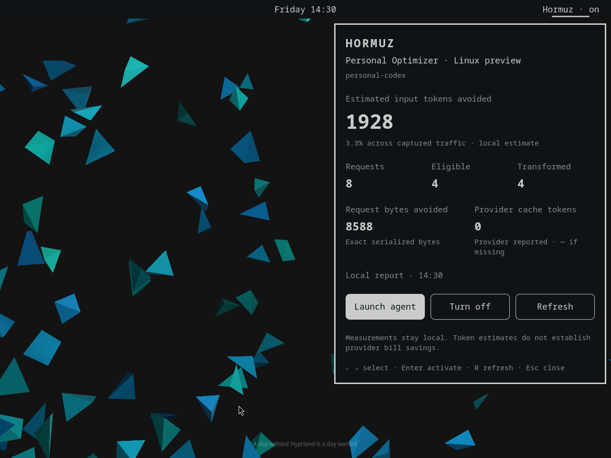

# Hormuz for Omarchy

A native Omarchy Quattro bar widget for **Hormuz Personal Optimizer**. Launch
an existing coding-agent profile in an Omarchy terminal, turn local optimization
on or off, and inspect the profile's content-free benefit report.

**Version 0.1.0 is a Linux integration preview.** The current Personal Optimizer
release contract qualifies macOS 14+ on Apple silicon, not Omarchy. The plugin
uses the existing Python CLI and Linux OS-keyring backend. It has been tested
with the real Omarchy shell, Hyprland, Secret Service, and pinned Codex in a
disposable local Linux VM. That fixture used Arch applications under Rosetta
and native systemd compatibility shims; it was not a fresh Omarchy ISO install.
See [QA.md](QA.md) for exact versions, results, and qualification limits.



The preview contains synthetic test measurements, not customer traffic.

## What the widget provides

- Bar indication of the saved optimization preference: on, off, or unknown.
  This is not a claim that an agent or relay is currently running.
- A themed popup with total, eligible, and transformed request counts;
  all-traffic local token estimates; exact serialized byte reduction; and
  provider-reported cache reads. Missing observations display `—`.
- **Launch agent** runs `hormuz personal run` for the selected profile in
  `omarchy-launch-terminal`, which preserves Omarchy's current terminal directory.
- **Turn on/off** changes the existing per-profile preference through Hormuz.
  **Refresh**, opening the panel, or a middle click reads a fresh local report.
- Arrow keys or `h/j/k/l` select an action; Enter/Space activates it;
  `R` refreshes; Escape closes; Tab follows Omarchy's panel switching.

The widget never starts a second Quickshell instance. It does not modify agent
configuration, collect credentials, implement routing, or contact a gateway
itself. Launching a saved profile uses that profile's existing provider or
managed-gateway connection. A managed profile retains Hormuz's own session
checks and does not fall back to direct mode.

## Dependencies

Runtime: Omarchy Quattro with its running shell, Python 3.11+, an installed
Hormuz CLI implementing `hormuz.personal-benefit` schema v1, and a saved
Personal Optimizer profile. Launching also needs `omarchy-launch-terminal`, a
private `XDG_RUNTIME_DIR`, the agent version supported by that Hormuz release,
and an unlocked Linux Secret Service or KWallet backend accepted by Hormuz.
The initial personal Codex contract pins **Codex CLI 0.148.0**. Agent adapters
and their qualification boundaries are owned by Hormuz, not this plugin.

Installation needs Omarchy's `omarchy plugin validate` command and GNU
`timeout`, `cp`, and `mv`, which are normal Arch core utilities. `qmllint` is
used for host validation. Installing the widget runs only as your desktop user.
The plugin installer copies its own files and enables its bar entry; dependencies
and profiles are configured separately. Provider usage starts when you launch
and use an agent.

## Install the prepared folder

Run inside the extracted plugin folder, as your normal Omarchy desktop user:

```sh
bash scripts/install.sh
```

The installer validates a staged copy, refuses an existing
`~/.config/omarchy/plugins/io.hormuz.optimizer`, places the plugin there,
rescans the running shell, and enables it in the right bar section. Temporary
staging is cleaned up on failure. If enabling fails after copying, the script
leaves the validated folder for you to inspect and prints a nonzero result.

You can also install this standalone repository with Omarchy's normal flow:

```sh
omarchy plugin add https://github.com/mehrdadxzaker/omarchy-hormuz-plugin --enable
```

This command installs the current upstream branch. Marketplace verification,
when granted, describes the exact commit shown by the marketplace. Review
updated source before using `omarchy plugin update io.hormuz.optimizer`.

## Prepare a profile

Install the pinned Hormuz source with its client/context extras in an isolated
environment. Review the referenced source commit before installation. This
integration was developed against Hormuz commit
`99b0435765c1d4a736c1cf5438216f4c5c434364` (distribution version 1.8.0).
There is no claim here that that version is published to PyPI.

```sh
python3 -m venv ~/.local/share/hormuz-venv
~/.local/share/hormuz-venv/bin/python -m pip install \
  'hormuz[client,context] @ git+https://github.com/mehrdadxzaker/hormuz.git@99b0435765c1d4a736c1cf5438216f4c5c434364'
~/.local/share/hormuz-venv/bin/hormuz context resources install
~/.local/share/hormuz-venv/bin/hormuz personal contract --json
```

Then create a profile in a terminal with an unlocked supported OS keyring.
If automatic backend discovery includes an unsupported store, select your
desktop's secure backend in Python Keyring's configuration. The GNOME Secret
Service fixture used this setting in `~/.config/python_keyring/keyringrc.cfg`:

```ini
[backend]
default-keyring=keyring.backends.SecretService.Keyring
```

Preserve other settings in an existing file. Use your desktop's supported
KWallet backend instead when that is the available secure store. Unlock the
collection through your normal desktop session; the plugin cannot unlock it.
Choose a model available to your provider account. In Bash, this keeps the
credential out of the command line and shell history:

```bash
read -rsp 'OpenAI API key: ' OPENAI_API_KEY; printf '\n'
export OPENAI_API_KEY
~/.local/share/hormuz-venv/bin/hormuz personal connect \
  --profile personal-codex --mode direct --agent codex --provider openai \
  --model YOUR_MODEL --credential-env OPENAI_API_KEY
unset OPENAI_API_KEY
```

Hormuz stores the provider credential in the OS keyring. The plugin reads
neither that credential nor the private profile JSON. The documented setup
does not itself qualify Linux execution. Existing personal profiles can be
selected immediately; an existing managed profile can be registered with
`hormuz personal connect --profile EXISTING_UUID --mode managed`.

## Configure

Edit only the widget's existing entry under `bar.layout.right` in
`~/.config/omarchy/shell.json`. The manifest also declares its settings metadata.
Keep other entries and the rest of that file intact. An example entry is:

```json
{
  "id": "io.hormuz.optimizer",
  "profile": "personal-codex",
  "hormuzCommand": "/home/YOUR_USER/.local/share/hormuz-venv/bin/hormuz",
  "stateDirectory": "",
  "showLabel": true
}
```

`hormuzCommand` is one executable name on the shell's PATH or one absolute
executable path, including paths with spaces. It is never interpreted as a
shell command. `stateDirectory` is empty for Hormuz's default or an absolute
private directory; `~/…` is expanded by the helper. The default respects
`HORMUZ_CLIENT_STATE_DIRECTORY`, otherwise it is `$XDG_CONFIG_HOME/hormuz`
or `~/.config/hormuz`. The terminal and shell must use the same environment,
or set an explicit `stateDirectory` to make the choice unambiguous.

Move, summon, or hide through the normal shell APIs:

```sh
omarchy bar move io.hormuz.optimizer --section right
omarchy-shell shell summon io.hormuz.optimizer '{}'
omarchy-shell shell hide io.hormuz.optimizer
```

## Resource and privacy behavior

The widget performs no HTTP requests. It reads a local report once at startup,
when opened, when settings change, or on an explicit refresh. There is no
periodic polling. One helper operation runs at a time per widget; each local
CLI call has an eight-second deadline and a 256 KiB output limit. A failed
operation clears the visible measurements and shows a fixed diagnostic,
without forwarding arbitrary CLI stdout/stderr or extra JSON fields.

Launches hold one advisory lock per effective state directory/profile under
`$XDG_RUNTIME_DIR/hormuz-omarchy`. Repeated clicks or separate monitor widgets
cannot start another plugin-owned session for that profile while its CLI is
alive. The wrapper replaces itself with Hormuz, preserving interactive terminal
behavior; Hormuz owns agent/relay cleanup. Ctrl+C or normal agent exit ends the
session. Closing the popup, disabling, or removing the widget leaves an
intentional terminal session running until you close it. An unlocked lock file
may remain until the OS removes the runtime directory; it contains no content
or credentials. Direct terminal launches outside this plugin do not share its lock.

Reports stay local. Estimated token reduction is not provider bill savings;
provider prompt-cache reads are not answer-cache hits. The plugin neither
exports reports nor transmits telemetry. There are no installation hooks that
launch agents or retrieve credentials.

## Disable and remove

```sh
omarchy plugin disable io.hormuz.optimizer
omarchy plugin remove io.hormuz.optimizer
```

These remove the shell integration. A running terminal session and its saved
Hormuz profile are separate. To deliberately delete that personal profile and
its direct credential, use `hormuz personal remove --profile personal-codex`
with the matching CLI and state-directory settings.

## Develop and validate

```sh
python3 -m unittest discover -s tests -v
omarchy plugin validate .
imports=$(mktemp -d)
trap 'rm -rf -- "$imports"' EXIT
ln -s "$OMARCHY_PATH/shell" "$imports/qs"
qmllint -I "$imports" BarWidget.qml Panel.qml Service.qml Metric.qml ActionButton.qml
```

See [QA.md](QA.md) for live click, keyboard, lifecycle, multi-monitor, and
provider-free Linux checks. Official references:
[Omarchy development guide](https://plugins.omarchy.org/develop.html),
[shell contract](https://github.com/omacom/omarchy/blob/quattro/docs/omarchy-shell.md),
[publishing guide](https://plugins.omarchy.org/publish.html).

Apache-2.0. The plugin uses public Omarchy/Quickshell interfaces and the
separately installed Hormuz CLI. It ships no Omarchy, Quickshell, or Qt runtime.

Planned GitHub ownership change: see [transfer preparation](docs/PERSONAL_TRANSFER.md).
